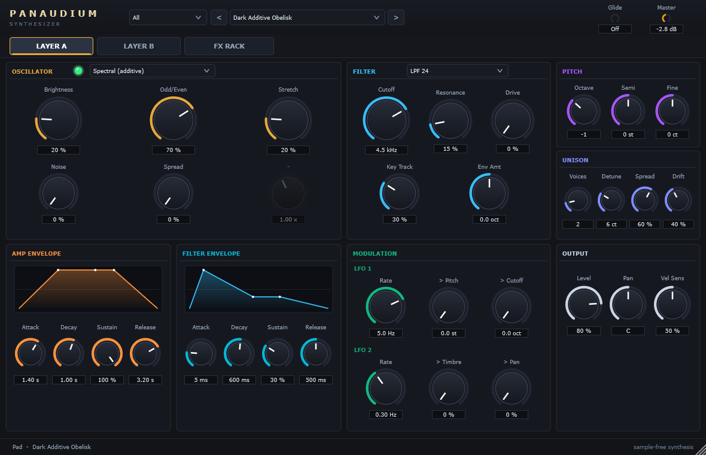
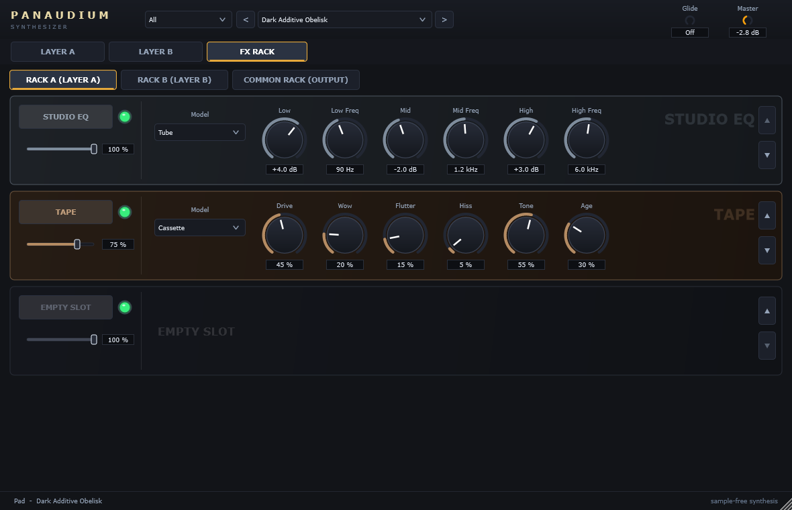

# Panaudium

An open-source, **sample-free** layered synthesizer plugin (VST3 + standalone, Windows) inspired by
Spectrasonics Omnisphere. Every sound is generated in code by physical models, formant, additive, granular and
analog-style synthesis. There are no recorded samples or impulse-response files anywhere, and the whole plugin is about 5 MB.




## Install

Download the latest installer from **[Releases](https://github.com/rdenno/panaudium/releases)**:

- `Panaudium-<version>-Windows-x64-Setup.exe` installs the VST3 into `C:\Program Files\Common Files\VST3`
  (the folder every DAW scans) and, optionally, the standalone app. Then rescan plugins in your DAW.
  In FL Studio, use *Options → Manage plugins → Find plugins*. FL only scans that standard folder for VST3s;
  custom search paths are treated as VST2 paths.
- `Panaudium-<version>-Windows-x64.zip` contains the same files for a manual install: copy `Panaudium.vst3` into the VST3 folder.

The binaries link the C++ runtime statically, so no Visual C++ redistributable is needed.

## What's inside

- **2 layers × 16 voices**, each layer with one of **9 synthetic engines**:
  - Analog/FM/sync
  - Spectral (additive)
  - Granular
  - Karplus-Strong plucked string
  - Modal resonator bank (morphs string → bar → bell → membrane)
  - Glottal-pulse + formant voice
  - STK-style flute
  - STK-style bowed string
  - Atmos (noise through a tuned comb)
- **Per layer:** unison with analog drift, drive, a filter (SVF LP/HP/BP/notch, formant, comb), amp and filter envelopes, and 2 LFOs.
- **Omnisphere-style FX rack**: 3 slots per layer plus 4 common slots, with **17 units and 84 models**:
  - Stompbox (Tube Screamer, Fuzz Face, Rat, Big Muff, ...)
  - Analog Phaser, Chorus/Ensemble, Flanger, Tremolo/Gate, Rotary (Leslie)
  - Delay, Pro-Verb (8×8 FDN)
  - **Innerspace**: convolution with *procedurally synthesised* impulse responses (Coin Dropper, Spring Tank, Metal Box, ...)
  - Shimmer, Studio EQ, Compressor (incl. Pump), Lo-Fi, Ring/Freq-shift, Wah/Env filter, Tape, Amp sim (synthetic cabinets)
- **115 factory presets** in 18 categories:
  - Pad, Atmos, Drone, Texture, Cinematic, Pulse, FX
  - Keys, Bass, Lead, Pluck, Mallet, World, Brass, Percussion, Strings, Wind, Vocal

  They are loudness-matched to −18 LUFS (standard deviation 0.2 LU).
- **Custom GUI**: layer pages with engine-specific knob labels, and the FX rack with per-unit themes and model menus.
  All parameters show real units, in the GUI and in host automation.

## Measured quality (reproducible with the scripts below)

| Check | Result |
|---|---|
| Pitch (pYIN) for all 9 engines, A2–A5 | in tune; bowed string C2–E6 and flute C2–A6 over full parameter grids |
| Preset loudness (BS.1770) | mean −18.1 LUFS, σ 0.20 LU (was 27 LU spread before matching) |
| Timbral diversity (MFCC/spectral/temporal features) | original 35 presets: mean pairwise 7.02, coverage 3.74 → all 115: **8.03 / 4.13**; 64 of 80 new presets sit outside the original sound space ([report](docs/analysis/diversity.html)) |
| FX torture test (17 units × 84 models × 4 knob extremes) | no NaN/Inf, bounded peaks, ≥29× realtime, default wet level 0.5–1.6× |
| Headless host test (VST3 hosting like a DAW, all 115 programs) | pass: programs, automation fuzz, 1–1024-sample blocks, 44.1–192 kHz, bit-exact state restore, editor open/close, ≥5× worst-block real-time headroom |
| pluginval (strictness 8) / Steinberg VST3 validator | pass / 47 of 47 |

## Build from source

```bash
cmake -S . -B build -G "Visual Studio 17 2022" -A x64
cmake --build build --config Release --target Panaudium_VST3 Panaudium_Standalone
```
JUCE 8.0.8 is fetched automatically, or a local `./JUCE` checkout is used if one exists.
`-DPANAUDIUM_BUILD_PLUGIN=OFF` builds only the JUCE-free DSP core tools.

Tools (all in `build/`):
- `panaudium_render <dir>` renders every preset to WAV. It also takes `--tuning` (pitch probes),
  `--probe <engine> <note> <timbre> <shape> <char>`, and `--fxtest` (the FX torture test plus a WAV per FX model).
- `panaudium_hosttest <Panaudium.vst3> <outdir> [--all-programs]` is the headless DAW-style test.
- `panaudium_snapshot <outdir> [program]` renders the GUI pages to PNG.

Analysis (Python: numpy, scipy, librosa, soundfile, matplotlib, pyloudnorm, scikit-learn):
- `analysis/loudness.py` measures loudness, and `write_trims.py` folds the trims into `src/dsp/presets/Trims.h`.
- `analysis/diversity.py` and `compare_banks.py` measure timbral diversity.
- `analysis/fx_models.py` checks that the FX models sound distinct.
- `analysis/tuning.py`, `pitchsweep.py` and `sweep.py` check engine pitch.

Every push of a `v*` tag builds, tests and publishes a release through GitHub Actions (`.github/workflows/release.yml`).

## How it relates to Omnisphere

The architecture comes from a reverse-engineering pass over the shipped `Omnisphere.vst3`, done with Ghidra via REA
plus string and RTTI analysis. It looked at the layered `RhLayeredSynthEngine`, the per-layer parameter block
(oscillator type, Timbre/Shape/Symmetry, FM/ring, unison+drift, dual filter, envelopes, LFOs), and the FX rack of
100+ `Eff*` units. The decompiled `VowelFilter` uses 128-step formant tables, a size scale and 5 two-pole resonators,
and Panaudium's Vocal engine follows that structure. No Spectrasonics code, samples or data are used; Panaudium
re-creates the *kinds* of sounds with synthesis instead of a sample library.

## How it was built

The DSP core, FX-rack architecture, integration and all verification were written by Claude (Anthropic).
Self-contained pieces went to Google's Antigravity agent (Gemini) through written briefs, kept in
`docs/agent-briefs/`. Those pieces were:
- the FX unit implementations;
- the GUI;
- preset banks 2 and 3;
- the loudness and diversity scripts.

Each delegated piece was then compiled, measured and corrected (see the commit history).

## License

AGPL-3.0 (see `LICENSE`), compatible with the JUCE dependency.
